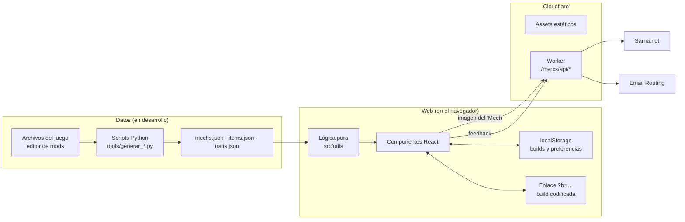
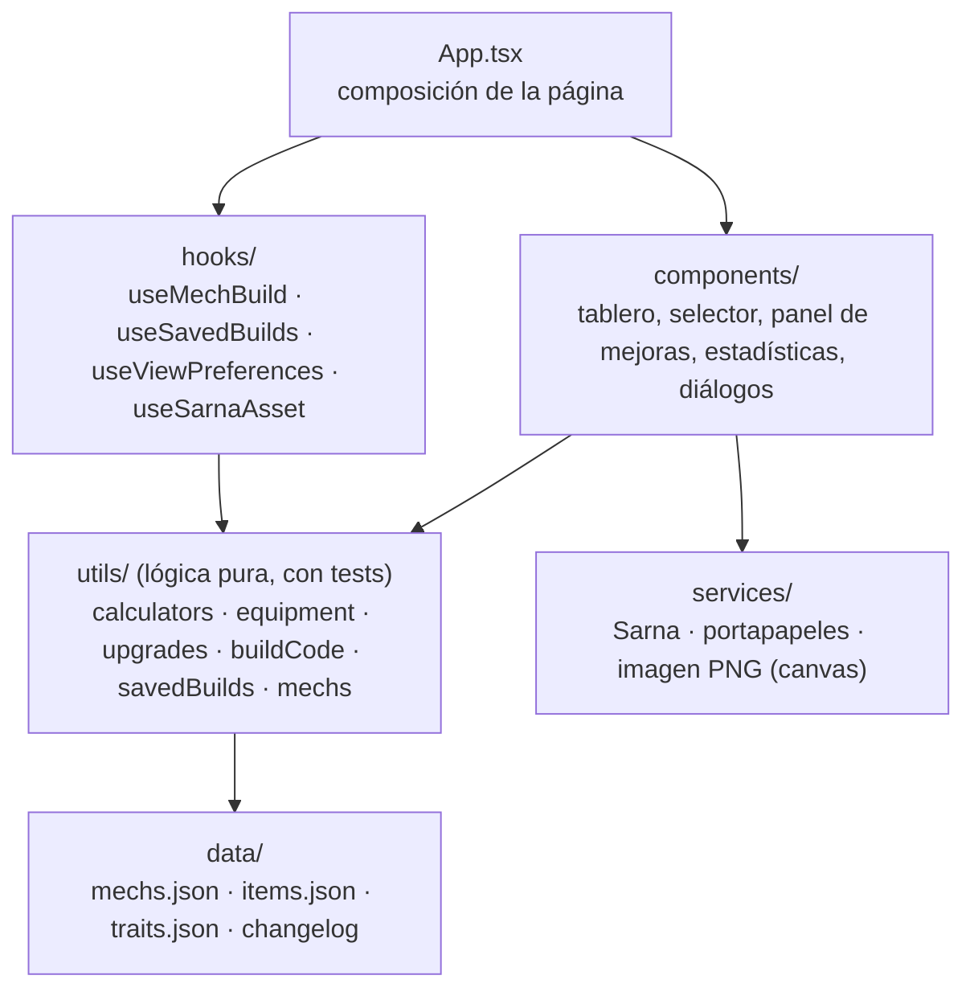

# Arquitectura

Los diagramas UML (casos de uso, clases del dominio y secuencias) están en [uml.md](uml.md).

## Visión general

MechLab es una web estática hecha con React y TypeScript. No tiene base de datos ni backend propio: los datos del juego van incluidos en el build como JSON, las builds del usuario se guardan en su navegador o viajan dentro de un enlace, y un pequeño Worker de Cloudflare atiende las dos únicas rutas que necesitan servidor.

## Flujo de datos del juego

Los datos se exportan con el editor de mods oficial de *MechWarrior 5: Mercenaries* a `tools/datos-juego/` y tres scripts de Python (sin dependencias externas) generan los JSON de `src/data/`:

| Script | Lee | Genera |
|---|---|---|
| `generar_items.py` | `items/` | `items.json`: armas por tier, equipo, munición, disipadores |
| `generar_mechs.py` | `mda/`, `mdl/`, `hps/`, `loadout/`, `unitcard/`, `mech_string_table/` e `items.json` | `mechs.json`: 639 variantes con componentes, anclajes, build de fábrica, año y rol |
| `generar_traits.py` | `traits/` | `traits.json`: las 50 mejoras de la cantina y sus efectos |

Algunos datos no están donde parecería:

- **El tamaño de cada anclaje** no está en el archivo del 'Mech (MDA). Hay que seguir su modelo (MDL) hasta la tabla de anclajes del chasis (HPS).
- **El nombre de cada chasis** solo aparece como una clave de texto; el texto está en la tabla `Mech_StringTable`.
- **La build de fábrica** está en otro archivo (`*_Loadout`) y sirve también para validar los datos.

Los scripts avisan al terminar de todo lo que no cuadra (piezas que no caben, variantes sin ficha, anclajes cuyo tamaño se ha tenido que deducir), para revisarlo con cada parche.

## Capas de la web

- **`utils/`** es el núcleo: funciones puras que reciben datos y devuelven datos, sin React ni efectos. Por ejemplo, `getBuildSummary(mech, loadout, armor, upgrades)` calcula todas las estadísticas. Es lo que cubren los tests.
- **`hooks/`** guarda el estado: la build en curso, las builds guardadas y las preferencias de vista.
- **`components/`** solo pinta y llama a la lógica.
- **`services/`** aísla lo que depende del exterior: la API de Sarna, el portapapeles y el canvas de la imagen.

## Decisiones de diseño

### La build viaja en el enlace

Una build compartida es un JSON compacto en base64url dentro de la URL: `[versión, id del mech, armadura, armas y equipo por zona, mejoras]`. Las armas guardan su anclaje y su tier solo si no es el de catálogo, y las mejoras solo se añaden si hay alguna.

- **A favor:** no hace falta servidor ni base de datos, el enlace funciona para siempre y no se recoge ningún dato.
- **Compatibilidad:** al abrir un enlace, la build se reconstruye con las reglas del taller y se descarta lo que ya no existe o no cabe, en vez de fallar. Por eso los enlaces y las builds guardadas siguen funcionando tras actualizar los datos. Los IDs de las variantes se mantienen aunque el juego cambie cómo las nombra (los campeones siguen siendo `ARC-2R (C)`).

### Lógica separada de la interfaz

Las reglas del juego (qué cabe en cada anclaje, cuánto pesa la armadura, cómo se suman las mejoras) están en funciones puras. Así se pueden probar con tests sin montar componentes, y las mismas funciones sirven para la web, la imagen PNG y los tests de referencia contra el juego.

### Un Worker solo para la API

Cloudflare sirve los archivos estáticos directamente; el Worker solo se ejecuta en `/mercs/api/*` (`run_worker_first` en `wrangler.jsonc`):

- **`/mercs/api/sarna-image`:** proxy de las imágenes de Sarna. Sarna no envía cabeceras CORS, así que el navegador no deja dibujar sus imágenes en un canvas para exportarlo. El proxy solo acepta imágenes de la wiki de Sarna, limita su tamaño y las guarda en la caché de Cloudflare.
- **`/mercs/api/feedback`:** recibe el formulario de feedback y lo envía por correo con Email Routing. La dirección de destino es un secreto del Worker.

En desarrollo, el servidor de Vite atiende esas mismas rutas con el mismo código (`vite.config.ts`).

### Estadísticas comprobadas contra el juego

Cuando una cifra no coincide con la del juego, se hace una captura del mechlab real y se convierte en un test (`gameReference.test.ts`, `upgrades.test.ts`). Así se descubrieron reglas que los archivos no dicen: los disipadores dobles de la Esfera Interior suman +1,0 a la refrigeración del motor, la Ferro-Fibrosa da 35,84 puntos por tonelada, el juego trunca en vez de redondear, o los porcentajes de las mejoras se suman en lugar de multiplicarse.

### Un dominio, una ruta por juego

`mw-builder.com` tiene una portada (`site/`) y cada juego vive en su propia ruta (`/mercs/`). Así se puede añadir *MechWarrior 5: Clans* más adelante sin tocar lo que ya existe.

## Principios de diseño

### SOLID

- **Responsabilidad única.** Cada módulo de `src/utils/` tiene un solo motivo para cambiar: `calculators.ts` calcula las estadísticas, `equipment.ts` decide qué cabe en cada anclaje y ranura, `buildCode.ts` define el formato del enlace, `upgrades.ts` aplica las mejoras y `buildActions.ts` agrupa las acciones sobre la build. Los componentes solo pintan, y `services/` aísla lo que depende del exterior.
- **Abierto/cerrado.** Los datos del juego dirigen el comportamiento: un ’Mech, un arma o una mejora nuevos llegan en los JSON sin tocar el código. Las mejoras de la cantina se describen como datos (`{ stat, value, weaponTypes }`), así que una mejora nueva con una estadística conocida no necesita código.
- **Sustitución de Liskov.** Un `EquippedItem` extiende `Item` y se puede usar en cualquier sitio que espere un objeto del catálogo: los cálculos reciben `Item` y funcionan igual con objetos equipados.
- **Segregación de interfaces.** Los componentes reciben solo lo que usan: `StatsReadout` recibe el resumen, `UpgradesPanel` las mejoras instaladas y sus acciones, sin acceso al resto del estado.
- **Inversión de dependencias.** La lógica recibe sus datos como parámetros en lugar de importarlos: `decodeBuild(código, mechs, catálogo)` o `getBuildSummary(mech, loadout, armadura, mejoras)`. Por eso los tests usan los datos reales o datos de prueba sin cambiar nada.

### DRY, KISS y YAGNI

- **DRY.** Las primeras refactorizaciones eliminaron la lógica duplicada de zonas, equipo, tipos y cálculos. Hoy las mismas funciones sirven a la web, a la imagen PNG y a los tests, y el Worker y el servidor de desarrollo de Vite comparten el mismo código (`worker/feedback.ts`, `worker/sarnaImage.ts`).
- **KISS.** Sin librería de estado (hooks de React), sin framework de estilos (CSS propio), sin backend (la build viaja en el enlace) y sin base de datos (`localStorage` para lo que guarda el usuario).
- **YAGNI.** Sin cuentas de usuario, sin servidor y sin *MW5: Clans* hasta que hagan falta. El dominio está preparado para otro juego (una ruta por juego), pero no se ha construido nada para él todavía.

## Relación con Clean Architecture

MechLab no sigue Clean Architecture al pie de la letra, pero su estructura respeta la idea central: las reglas del negocio (las del juego) están en el centro, sin depender de React, del navegador ni de Cloudflare.

| Capa de Clean Architecture | En MechLab |
|---|---|
| Entidades y reglas del dominio | `src/types/` y las funciones puras de `src/utils/`: anclajes, ranuras, armadura, estadísticas, mejoras |
| Casos de uso | `src/utils/buildActions.ts` (cambiar un arma, duplicarla, mover equipo…) y las acciones de `useMechBuild`: reciben la build y devuelven la build nueva |
| Adaptadores | `src/services/` (API de Sarna, portapapeles, imagen en canvas), `useSavedBuilds` (`localStorage`), `buildCode.ts` (la URL) y `worker/` (correo y proxy) |
| Frameworks y drivers | React, Vite y Cloudflare Workers |
| Raíz de composición | `App.tsx`: crea el estado y conecta la lógica, los servicios y los componentes |

**La regla de dependencias** se cumple casi siempre: `src/utils/` no importa componentes, hooks ni React. Hay tres excepciones pequeñas y conocidas: `menuPosition.ts` usa un tipo de evento de React, `mechs.ts` usa `getSarnaTitle` de `services/` para buscar por el nombre de Sarna, y `upgrades.ts` importa directamente `traits.json` en lugar de recibirlo como parámetro.

**Por qué no se aplica entera.** Clean Architecture compensa cuando hay persistencia compleja o varios adaptadores intercambiables para una misma necesidad. Aquí no los hay: lo único que se guarda es una lista de builds en `localStorage` y un código en la URL, hay una sola interfaz y una sola fuente de datos. Añadir puertos, interfaces y una raíz de composición formal metería capas de indirección sin ningún beneficio, justo lo que piden evitar KISS y YAGNI. El punto donde sí compensaría es el día que exista un segundo juego: los datos de cada juego serían adaptadores de un mismo puerto.

## Despliegue

- `npm run build` genera la web en `dist/mercs/` y copia `site/` en la raíz.
- Cada fusión en `main` se publica automáticamente en Cloudflare Workers, y cada pull request tiene una URL de vista previa.
- GitHub Actions ejecuta lint, tests con cobertura y build en cada push y pull request, y CodeQL analiza la seguridad del código. Dependabot propone las actualizaciones de dependencias.
