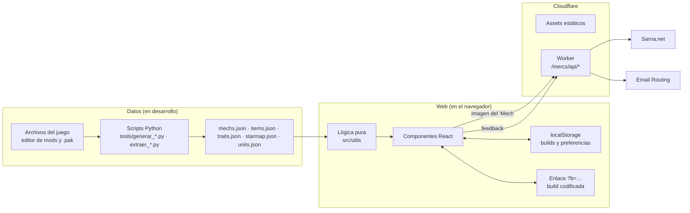
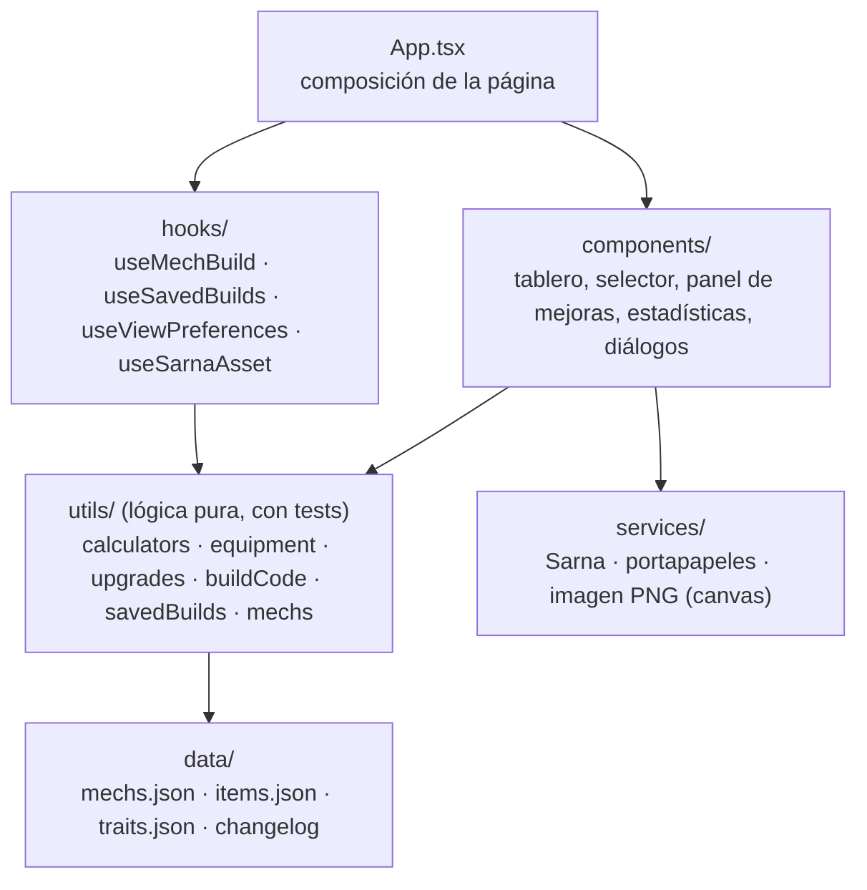

# Arquitectura

Los diagramas UML (casos de uso, clases del dominio y secuencias) están en [uml.md](uml.md).

## Visión general

MechLab es una web estática hecha con React y TypeScript. No tiene base de datos ni backend propio: los datos del juego van incluidos en el build como JSON, las builds del usuario se guardan en su navegador o viajan dentro de un enlace, y un pequeño Worker de Cloudflare atiende las dos únicas rutas que necesitan servidor.

## Flujo de datos del juego

Los datos se exportan con el editor de mods oficial de *MechWarrior 5: Mercenaries* a `tools/datos-juego/` y tres scripts de Python (sin dependencias externas) generan los JSON de `src/data/`:

| Script | Lee | Genera |
|---|---|---|
| `generar_items.py` | `items/` y los rasgos de los computadores de puntería de `traits/` | `items.json`: armas por tier con su fabricante, equipo con sus efectos, munición, disipadores y DLC |
| `generar_mechs.py` | `mda/`, `mdl/`, `hps/`, `loadout/`, `unitcard/`, `mech_string_table/` e `items.json` | `mechs.json`: 639 variantes con componentes, anclajes, build de fábrica, año y rol |
| `generar_traits.py` | `traits/` | `traits.json`: las 50 mejoras de la cantina y sus efectos |
| `generar_mapa.py` | `starmap/` (lo extrae `extraer_mapa.py` del `.pak` de la instalación) | `starmap.json`: 2172 sistemas con su dueño de 3015 a 3060, facciones, eventos, clústeres y centros industriales con su reputación recomendada y su dificultad; `availability.json`: la rareza de cada variante por facción (de las unit cards, con las funciones de `generar_mechs.py`); `quest-briefings.json`: el briefing de cada misión de las HRQ, aparte para que el mapa no cargue los textos |
| `generar_unidades.py` | `unitcard/` y `unidades/` (lo extrae `extraer_unidades.py` del `.pak`) e `items.json` | `units.json`: 115 unidades enemigas (tanques, aerodeslizadores, VTOL, torretas y armaduras de combate) con su vida base, velocidad, armas en el formato de `items.json` y rareza por facción |

Algunos datos no están donde parecería:

- **El tamaño de cada anclaje** no está en el archivo del 'Mech (MDA). Hay que seguir su modelo (MDL) hasta la tabla de anclajes del chasis (HPS).
- **El nombre de cada chasis** solo aparece como una clave de texto; el texto está en la tabla `Mech_StringTable`.
- **La build de fábrica** está en otro archivo (`*_Loadout`) y sirve también para validar los datos.

- **El mapa estelar** no se puede exportar con el editor de mods, así que `extraer_mapa.py` lee el `.pak` de la instalación con un lector propio de Unreal Engine 4 (`tools/ue4.py`). El color de cada facción no está en la facción: sale del estencil del mapa y de la colección de parámetros `Faction_Colours_MPC`.

Los scripts avisan al terminar de todo lo que no cuadra (piezas que no caben, variantes sin ficha, anclajes cuyo tamaño se ha tenido que deducir), para revisarlo con cada parche.

## Capas de la web

- **`utils/`** es el núcleo: funciones puras que reciben datos y devuelven datos, sin React ni efectos. Por ejemplo, `getBuildSummary(mech, loadout, armor, upgrades)` calcula todas las estadísticas. Es lo que cubren los tests.
- **`hooks/`** guarda el estado: la build en curso, las builds guardadas y las preferencias de vista.
- **`components/`** solo pinta y llama a la lógica.
- **`utils/inventory.ts`:** el inventario del MechLab (`InventoryPanel`), que hace de panel de componente: las categorías, los filtros (con «cabe en este 'Mech» o en el componente o anclaje elegido), el orden, los anclajes y componentes donde se puede soltar cada objeto (también uno ya equipado, que se mueve), la colocación, que reemplaza el arma de un anclaje ocupado, el lugar adecuado del clic derecho y desequipar. Usa las reglas de `equipment.ts` y `buildActions.ts`, sin copiarlas, y tiene sus tests (`inventory.test.ts`).
- **`services/`** aísla lo que depende del exterior: la API de Sarna, el portapapeles y el canvas de la imagen. Las ayudas de dibujo son comunes (`canvasDrawing.ts`); cada MechLab dibuja la suya (`buildImage.ts` para MW5 y `battletech/buildImage.ts` para BATTLETECH) y `ShareImageDialog` recibe la función que la dibuja.

### Mapa estelar

El mapa es otra página (`starmap/index.html`, servida en `/mercs/starmap/`) con su propio bundle, así que el MechLab no descarga sus datos. Sigue la misma separación:

- **`utils/starmap.ts`:** el dueño de cada sistema en una fecha, los eventos, los centros industriales, la reputación y la dificultad de cada zona, la búsqueda, la rejilla de territorios y el contorno de los clústeres. Son funciones puras con sus tests (`starmap.test.ts`).
- **`utils/campaigns.ts`:** las campañas de los DLC: la búsqueda, las que empiezan o pasan por un sistema, su ruta (el inicio y cada misión, sin repetir un sistema seguido), si ya se ofrecen en una fecha y la campaña de la URL. El renderer dibuja su ruta con el mismo código que la de las HRQ, en su propio color.
- **`utils/marks.ts`:** qué sistemas marca el mapa con el aro, las esquinas de mira y el nombre (el elegido, la academia, la oferta de la HRQ, el inicio de la campaña y dónde se consigue una variante), sin repetir un sistema. El renderer pinta cada tipo en el color de su panel.
- **`utils/academies.ts`:** las academias de pilotos abiertas en una fecha (con su fundación y su cierre cuando un Clan toma el sistema, que es permanente), las de un sistema, la búsqueda y la descripción de cada programa.
- **`utils/mercs.ts`:** el dueño de una zona de influencia de los mercenarios rivales en una fecha (con la rotación al azar al acabar el historial), las zonas de una compañía y la zona bajo un punto.
- **`utils/clusters.ts`:** la zona de conflicto bajo un punto del mapa (con los mismos contornos que dibuja el renderer), la descripción del recargo de reparación y de los contratos de varias misiones, y la arena de un sistema.
- **`utils/availability.ts`:** la tabla de rareza que usa cada facción (la suya o la de su alianza), la rareza de una variante en una fecha, sus fuentes fijas y la lista de 'Mechs hero. La rareza va en `availability.json`, que el mapa carga con un `import()` al abrir Find a 'Mech o Hero 'Mechs, así que no pesa en la carga inicial.
- **`starmap/renderer.ts`:** pinta en un canvas. La rejilla que dice a qué sistema pertenece cada punto del mapa se calcula una vez, porque no depende de la fecha. Al mover la fecha solo se vuelve a colorear y se genera la textura de territorios, con el borde brillante como en el juego. El arrastre y el zoom solo redibujan esa textura.
- **Novedades en la portada:** la portada (`site/index.html`) es HTML estático, así que el build escribe `changelog.json` en la raíz a partir de `src/data/changelog.ts`. La campana de la portada lo lee y guarda lo ya visto con la misma clave que la del MechLab.
- **`starmap/StarmapApp.tsx`:** la ficha del sistema, el control de fecha, el buscador y la leyenda. La fecha y el sistema elegido van en la URL.

### Unidades enemigas

Es la tercera página (`units/index.html`, servida en `/mercs/units/`), también con su propio bundle:

- **`utils/units.ts`:** las armas de una unidad con su daño, DPS y alcance (con `getWeaponStats`, la misma función que el MechLab, porque `units.json` guarda las armas en el formato de `items.json`), la potencia de fuego, los filtros, el orden, la rareza agrupada y la vista en la URL. Tiene sus tests (`units.test.ts`).
- **Las armas, en el bytecode:** las torretas montan sus cañones como `ChildActorComponent` y les dan la clase en el script de construcción con `SetChildActorClass`, así que `extraer_unidades.py` busca esa llamada en el bytecode de `UserConstructionScript` para saber qué arma va en cada componente.
- **Dibujos de Sarna:** el juego no los trae, así que `generar_unidades.py` tiene una tabla con el título de Sarna de cada chasis e `imagenes_sarna.py` busca una vez su página y su dibujo en la API de Sarna. Van en `units.json`: la página no consulta Sarna al cargar, solo descarga los dibujos de las fichas que se ven.
- **`units/UnitsApp.tsx`:** los filtros, el orden y la ficha de cada unidad. Solo pinta y llama a la lógica.

### Pilotos

Es la cuarta página (`pilots/index.html`, servida en `/mercs/pilots/`), con su propio bundle. Usa los estilos de las unidades enemigas (`units.css`) y solo añade los suyos y el color de acento:

- **Efectos en los datos:** `generar_pilotos.py` convierte cada propiedad de los componentes de un rasgo en un efecto con texto, valor y si es bueno, y los agrupa por dónde se aplican (con unos 'Mechs, con un arma, contra una facción, al piloto). La página no interpreta cifras del juego: solo las pinta.
- **El árbol de componentes:** cada rasgo apunta a su componente principal (`UnitTrait`) y este a los suyos (`UnitTraits`). Se siguen esas referencias, porque algunos assets traen componentes sueltos que el rasgo no usa. Para ello `ue4.py` guarda el orden de los exports.
- **Orden en los datos:** `generar_pilotos.py` da a cada rasgo su subgrupo (clase de peso, clase de arma, tipo de facción…) y los deja ordenados; a cada programa, su familia y lo que lo distingue dentro de ella (nivel, curso o academia). La página solo los agrupa en ese orden.
- **Pilotos hero:** sus habilidades llegan ya en niveles (la curva del juego convierte la experiencia), y sus rasgos son ids de la lista de rasgos, para enseñar los mismos efectos. Sus retratos son PNG estáticos en `public/pilots/portraits/`, como los logos de facción, y `pilots.json` solo guarda el nombre del archivo.
- **`utils/pilots.ts`:** los filtros por categoría y hero, la búsqueda por nombre o efecto, las secciones de rasgos, las familias de programas, la duración en años y la vista en la URL. Tiene sus tests (`pilots.test.ts`).
- **`pilots/PilotsApp.tsx`:** las pestañas de pilotos hero, rasgos y programas, las fichas y las tablas. Solo pinta y llama a la lógica.

### Armas y equipo

Es la quinta página de MW5 (`equipment/index.html`, servida en `/mercs/equipment/`), con su propio bundle. Lee el mismo `items.json` que el MechLab y, como los pilotos, usa los estilos de las unidades enemigas (`units.css`) con su color de acento (`equipment/equipment.css`):

- **Datos nuevos en `items.json`:** `generar_items.py` añade el fabricante de cada tier, el DLC de cada objeto y los efectos del equipo: retrorreactores, ECM, sondas, MASC y Supercharger, y los computadores de puntería, que guardan sus efectos en un rasgo de `traits/` (`EquipmentTrait`). Solo añade campos: lo que ya usaba el MechLab no cambia.
- **`utils/arsenal.ts`:** las filas de la tabla de armas en un tier (con `getWeaponStats`, la misma función que el MechLab; las armas Clan enseñan su único tier), la munición por tonelada, los filtros, el orden por columnas (sin el dato, al final), las categorías y los efectos del equipo, las armas que usan cada munición y la vista en la URL. Tiene sus tests (`arsenal.test.ts`).
- **`equipment/EquipmentApp.tsx`:** las pestañas de armas y equipo, la tabla de armas (que se desplaza dentro de su caja, con el nombre fijo), las fichas de equipo y la tabla de munición. Solo pinta y llama a la lógica.

### Lista de chasis

Es la séptima página de MW5 (`chassis/index.html`, servida en `/mercs/chassis/`), con su propio bundle. Lee el mismo `mechs.json` que el MechLab, sin datos nuevos ni el catálogo de equipo, y usa los estilos de las unidades enemigas (`units.css`) y la tabla de la página de armas (`equipment/equipment.css`) con su color de acento (`chassis/chassis.css`):

- **`utils/chassisList.ts`:** las filas de cada variante (las cifras del chasis, con la capacidad de calor y la refrigeración del chasis vacío), los filtros (los del selector de 'Mechs de `utils/mechs.ts`, sin copiarlos, más el tonelaje y la velocidad), el enlace al MechLab (`/mercs/?mech=AS7-D`) y la vista en la URL. Tiene sus tests (`chassisList.test.ts`).
- **`utils/tableSort.ts`:** el orden por columnas de las dos listas de chasis (sin el dato, al final; a igualdad, por nombre).
- **`components/ChassisTable.tsx`:** la tabla de las dos listas, que se desplaza dentro de su caja con el nombre fijo, y los contadores de mínimos.
- **`chassis/ChassisApp.tsx`:** los filtros de MW5 y las columnas de su tabla. Solo pinta y llama a la lógica.

### HRQ y campañas

Es la sexta página de MW5 (`campaigns/index.html`, servida en `/mercs/campaigns/`), con su propio bundle. Lee las HRQ, las campañas y los nombres de los DLC de `starmap.json`, las mismas del mapa estelar, y usa los estilos de las unidades enemigas (`units.css`) con su color de acento (`campaigns/campaigns.css`):

- **`utils/questGuide.ts`:** los grupos de HRQ por origen, la búsqueda (la misma del mapa, `searchQuests` y `searchCampaigns`) con el filtro por origen, los 'Mechs de cada recompensa sin repetir, el pago total de una campaña, la vista en la URL y los enlaces al mapa. Estos usan `toMapQuery` con la primera fecha en que se ofrece la HRQ o la campaña, para que el mapa no la enseñe como «todavía no se ofrece». Tiene sus tests (`questGuide.test.ts`).
- **`campaigns/CampaignsApp.tsx`:** las pestañas, los filtros y las listas con una fila plegable por HRQ, campaña o historia contada con HRQ. Solo pinta y llama a la lógica.

### BATTLETECH

Las páginas de *BATTLETECH* viven en `/battletech/`, con su propio build (`vite.battletech.config.ts`): la raíz de Vite es `battletech/`, el código está en `src/battletech/` y `src/utils/battletech/`, y se construye en `dist/battletech/` después del build de MW5, que es el que vacía `dist/` y copia la portada. Los plugins comunes (la portada y la API de desarrollo) están en `vite.plugins.ts`, y el Worker trata `/battletech/api/*` igual que `/mercs/api/*`.

- **Mapa estelar:** `generar_mapa_battletech.py` escribe `starmap.json` con la forma de `StarmapData`, el tipo del mapa de MW5 (una sola fecha, un dueño por sistema y el resto vacío), para reutilizar `StarmapCanvas` y su renderer: territorios, zoom, buscador y marcas. Lo propio de BATTLETECH (dificultad, etiquetas, tiendas, contratos y biomas) va en `details`. Como en el juego, el logo de cada facción se pinta casi transparente sobre su territorio: `getFactionEmblems` (en `src/utils/starmap.ts`, común a los dos mapas) calcula dónde y de qué tamaño, y el lienzo los recibe en `emblems`, que el mapa de MW5 no usa. Del mismo modo, `look` (sistemas del color de su dueño y territorios rayados) y `matches` (los sistemas que cumplen los filtros; el resto se atenúa) solo los pasa el mapa de BATTLETECH.
- **`utils/battletech/starmap.ts`:** los grupos de etiquetas, la leyenda de facciones y el sistema de la URL, con sus tests.
- **`battletech/starmap/BtStarmapApp.tsx`:** la cabecera, el buscador, la leyenda y la ficha del sistema. Usa los estilos del mapa de MW5 (`starmap.css`) y añade los suyos.

### MechLab de BATTLETECH

Es la página principal del build de BATTLETECH (`battletech/index.html`, servida en `/battletech/`), con su propio bundle: no carga los datos de MW5. Usa los estilos del MechLab de MW5 (`index.css` y `App.css`) y añade los suyos (`battletech/mechlab/mechlab.css`), con el amarillo de BATTLETECH como acento.

- **Datos de los DLC:** el juego base trae JSON sueltos, pero Heavy Metal, Flashpoint y Urban Warfare los guardan en bundles de Unity 2018. `tools/unityfs.py` los lee en Python puro (la tabla de bloques en LZ4, los SerializedFile v17 y sus TextAsset), sin dependencias. `extraer_mechlab_battletech.py` guarda cada chasis, variante y componente con su fuente; `generar_mechlab_battletech.py` deja las 96 variantes que el jugador puede tener (`unit_release` y sin `BLACKLISTED`), con su build de serie, y el catálogo de objetos.
- **Reglas propias:** las de BATTLETECH no se parecen a las de MW5 (todo ocupa ranuras, las armas usan anclajes por tipo, el blindaje va en pasos de 5 y no hay motor que cambiar), así que su lógica está aparte en `utils/battletech/`, con sus tipos en `types/battletech-mechlab.ts`:
  - `fitting.ts`: ranuras, anclajes por ubicación, ubicaciones permitidas, retrorreactores (máximo y tramo de tonelaje) y equipo fijo;
  - `armor.ts`: máximos delantero y trasero, pasos de 5 y el reparto del tonelaje libre con los porcentajes del juego;
  - `stats.ts`: peso, calor, daño, daño por distancia, munición, movimiento y coste;
  - `issues.ts`, `buildCode.ts`, `savedBuilds.ts`, `compare.ts` y `filters.ts`.

  Tiene sus tests (`mechlab.test.ts`), que comprueban las builds de serie contra las cifras del juego, y `gameReference.test.ts`, con las cifras de capturas de la pantalla de reequipar del juego (RFL-3C), como `gameReference.test.ts` de MW5.
- **Lo que se comparte con MW5:** las ubicaciones (`utils/zones.ts`), los componentes genéricos (`BuildStatus`, `UtilityToolbar` (con el grupo Cantina solo en MW5), `ContextMenu`, `SaveBuildDialog`, `CheckboxDropdown`, `SlotBar`, `Toast`, `FeedbackDialog`, `WhatsNew` y `SupportLink`), los hooks `useLongPress` y `useViewPreferences` (con la clave de cada juego; la lectura de lo guardado, con las ranuras como celdas por defecto, está en `utils/viewPreferences.ts`) y las clases de MW5 de las tarjetas, el panel, las tarjetas de objeto, el análisis y la comparación (`component-card`, `hardpoint-chip`, `component-editor`, `item-option`, `loadout-analysis`, `compare-card`) y lo común de las builds guardadas, que pasa a `utils/savedBuildsCore.ts` para no cargar el catálogo de MW5. El buscador, el orden y el filtro de la ventana My builds también son comunes: `utils/savedBuildsList.ts` (cada juego resume sus builds en filas con el chasis, la clase, el tonelaje y la potencia de fuego), los componentes `BuildsListControls` (con el interruptor que compara los mínimos con los anclajes o con las armas), `WeaponTypeCounts` y `BuildTagList`, el hook `useBuildSort`, que recuerda el orden con la clave de cada juego, y `useBuildListFilters`, con el buscador, los filtros y el orden de una lista. Cada juego resume sus builds guardadas en `utils/savedBuildRows.ts` y `utils/battletech/savedBuildRows.ts`, con lo que cambia de un juego a otro en las listas (`MERCS_BUILD_LIST` y `BT_BUILD_LIST`): lo usan la ventana My builds y el selector `SavedBuildPicker`, con el que el comparador elige una build guardada con los mismos filtros. Las etiquetas de tecnología de cada build dependen del juego: `utils/buildTags.ts` (MW5) y `utils/battletech/buildTags.ts`. `useSavedBuilds` recibe la clave del navegador de cada juego (`mw-builder:battletech:saved-builds`), y el archivo exportado lleva `game: "battletech"`.
- **`battletech/mechlab/BtMechLabApp.tsx`:** la cabecera, la lectura, el estado de la build, la barra de herramientas, el tablero (`BtBoard`), el inventario (`BtInventoryPanel`, el mismo que el de MW5 con las columnas de BATTLETECH y la lógica de `utils/battletech/inventory.ts`, con sus tests), el menú del clic derecho (`btMenus.ts`, con las acciones de `utils/battletech/actions.ts`), el análisis, la comparación y los diálogos. Solo pinta y llama a la lógica.
- **Iconos:** los de cada chasis son PNG estáticos en `battletech/public/mechlab/icons/`; `mechs.json` solo guarda su nombre.

### Argo de BATTLETECH

Es una página del build de BATTLETECH (`battletech/argo/index.html`, servida en `/battletech/argo/`), con su propio bundle. Usa los estilos de las unidades enemigas (`units.css`) y añade los suyos (`battletech/argo/argo.css`):

- **Datos sin interpretar en la página:** `extraer_argo_battletech.py` copia los JSON del juego tal cual y `generar_argo_battletech.py` deja cada mejora con su id corto (`mechBay2`), su nivel en el árbol, sus requisitos y sus efectos como estadística, valor y si la fija o la suma. Las frases con que el juego explica cada estadística van en `argo.json` como plantillas (`+{value} Tech Points`), así que la página dice lo mismo que el juego sin textos propios.
- **`utils/battletech/argo.ts`:** el árbol (requisitos y lo que abre cada mejora, directos o no), el plan (marcar añade los requisitos, desmarcar quita lo que depende y las iniciales no se quitan), el coste de llegar a una mejora desde el plan, los totales (coste, mantenimiento base más el de cada mejora), el efecto conjunto (las mejoras que fijan una estadística se sustituyen y las que suman se suman) y el plan en la URL, con solo las mejoras que no son requisito de otra. Tiene sus tests (`argo.test.ts`).
- **`battletech/argo/ArgoApp.tsx`:** la portada, la pantalla Ship Upgrades del juego (secciones de `groupBySection`, iconos SVG pintados con una máscara según el estado y la ficha en una ventana), el árbol con el resaltado de requisitos, las fichas por categoría y el plan, que en el móvil es una barra fija abajo. Solo pinta y llama a la lógica.
- **Imágenes:** las ilustraciones de las mejoras y los retratos de la tripulación son PNG estáticos en `battletech/public/argo/`; `argo.json` solo guarda su nombre.

### Armas y equipo de BATTLETECH

Es una página del build de BATTLETECH (`battletech/equipment/index.html`, servida en `/battletech/equipment/`), con su propio bundle. Lee el mismo `items.json` que el MechLab de BATTLETECH, sin cambios, y usa los estilos de las unidades enemigas (`units.css`) con su color de acento (`battletech/equipment/equipment.css`), como la Argo:

- **Sin los 'Mechs:** las etiquetas de fuente, anclaje y rareza pasan de `mechlabData.ts` y `filters.ts` a `utils/battletech/catalog.ts`, que no importa datos; los dos módulos las reexportan, así que el MechLab no cambia. La página importa `catalog.ts` y no carga `mechs.json`.
- **`utils/battletech/equipment.ts`:** las filas de la tabla de armas (el daño de un ataque, la inestabilidad por los disparos, la precisión con el signo del juego y la munición por tonelada), los filtros por anclaje, versión, fuente, rareza y búsqueda, el orden por columnas (sin el dato, al final), las categorías y los efectos del equipo (con dónde se monta), las mejoras por grupo, las armas que usan cada munición y la vista en la URL. Recibe el catálogo como parámetro y tiene sus tests (`equipment.test.ts`).
- **`battletech/equipment/BtEquipmentApp.tsx`:** las pestañas de armas y equipo, la tabla de armas con las bonificaciones de cada fabricante, las fichas de equipo y la tabla de munición. Solo pinta y llama a la lógica.

### Lista de chasis de BATTLETECH

Es una página del build de BATTLETECH (`battletech/chassis/index.html`, servida en `/battletech/chassis/`), con su propio bundle y los estilos de la lista de MW5:

- **`utils/battletech/chassisList.ts`:** las filas de cada variante con las cifras de su chasis vacío (sin equipo ni armadura, con su equipo fijo), calculadas con `getBuildSummary` como en el MechLab, el equipo fijo con las etiquetas de My builds, los filtros del selector (`filterBtMechs`) más el tonelaje y la distancia de correr, el orden (con `utils/tableSort.ts`), el enlace al MechLab (`/battletech/?mech=HBK-4G`) y la vista en la URL. Tiene sus tests (`chassisList.test.ts`).
- **`battletech/chassis/BtChassisApp.tsx`:** los filtros y las columnas, con la tabla común (`components/ChassisTable.tsx`). Solo pinta y llama a la lógica.

### Flashpoints de BATTLETECH

Es una página del build de BATTLETECH (`battletech/flashpoints/index.html`, servida en `/battletech/flashpoints/`), con su propio bundle. Usa los estilos de las unidades enemigas (`units.css`) y los de HRQ & Campaigns de MW5 (`campaigns.css`), con sus listas plegables y su rosa, y añade los caminos (`battletech/flashpoints/flashpoints.css`):

- **Datos:** `extraer_flashpoints_battletech.py` saca de los bundles de los tres DLC los flashpoints, su grafo de hitos (recortado a lo que lleva de uno a otro), sus contratos y las colecciones de recompensa. `generar_flashpoints_battletech.py` recorre el grafo desde el inicio, saca cada camino hasta un final (con la opción por defecto de cada bifurcación y sin los que abandonan), separa el tronco común, junta los caminos que se juegan igual y deja en `src/data/battletech/flashpoints.json` cada flashpoint con su sistema (por la etiqueta del planeta), sus requisitos, sus caminos con su pago y su recompensa.
- **`utils/battletech/flashpoints.ts`:** los grupos por DLC, la búsqueda, los enlaces al mapa y al MechLab y la vista en la URL. Tiene sus tests (`flashpoints.test.ts`).
- **`battletech/flashpoints/BtFlashpointsApp.tsx`:** los filtros y las filas plegables. Solo pinta y llama a la lógica.

### Unidades enemigas de BATTLETECH

Es una página del build de BATTLETECH (`battletech/units/index.html`, servida en `/battletech/units/`), con su propio bundle. Usa los estilos de las unidades enemigas de MW5 (`units.css`), con su mismo rojo, y añade el blindaje por ubicación (`battletech/units/units.css`):

- **Datos:** `extraer_unidades_battletech.py` lee los vehículos, las torretas, sus chasis y su movimiento del juego base y de los bundles de los DLC; `generar_unidades_battletech.py` deja en `src/data/battletech/units.json` las unidades que no están vetadas, con el blindaje de la definición, la estructura del chasis, el movimiento y su inventario por id. Las estadísticas de las armas no se copian: están en el mismo `items.json` que el MechLab.
- **`utils/battletech/units.ts`:** las armas de cada unidad (el daño de un ataque, con sus disparos), la potencia de fuego, el blindaje, los filtros, el orden (sin el dato, al final) y la vista en la URL. Recibe el catálogo como parámetro y tiene sus tests (`units.test.ts`).
- **`battletech/units/BtUnitsApp.tsx`:** los filtros y la ficha de cada unidad. Solo pinta y llama a la lógica.

## Decisiones de diseño

### La build viaja en el enlace

Una build compartida es un JSON compacto en base64url dentro de la URL: `[versión, id del mech, armadura, armas y equipo por zona, mejoras]`. Las armas guardan su anclaje y su tier solo si no es el de catálogo, y las mejoras solo se añaden si hay alguna.

- **A favor:** no hace falta servidor ni base de datos, el enlace funciona para siempre y no se recoge ningún dato.
- **Compatibilidad:** al abrir un enlace, la build se reconstruye con las reglas del taller y se descarta lo que ya no existe o no cabe, en vez de fallar. Por eso los enlaces y las builds guardadas siguen funcionando tras actualizar los datos. Los IDs de las variantes se mantienen aunque el juego cambie cómo las nombra (los campeones siguen siendo `ARC-2R (C)`).

### Lógica separada de la interfaz

Las reglas del juego (qué cabe en cada anclaje, cuánto pesa la armadura, cómo se suman las mejoras) están en funciones puras. Así se pueden probar con tests sin montar componentes, y las mismas funciones sirven para la web, la imagen PNG y los tests de referencia contra el juego.

### Un Worker solo para la API

Cloudflare sirve los archivos estáticos directamente; el Worker solo se ejecuta en `/mercs/api/*` (`run_worker_first` en `wrangler.jsonc`):

- **`/mercs/api/sarna-image`:** proxy de las imágenes de Sarna. Sarna no envía cabeceras CORS, así que el navegador no deja dibujar sus imágenes en un canvas para exportarlo. El proxy solo acepta imágenes de la wiki de Sarna, limita su tamaño y las guarda en la caché de Cloudflare.
- **`/mercs/api/feedback`:** recibe el formulario de feedback y lo envía por correo con Email Routing. La dirección de destino es un secreto del Worker.

En desarrollo, el servidor de Vite atiende esas mismas rutas con el mismo código (`vite.config.ts`).

### Estadísticas comprobadas contra el juego

Cuando una cifra no coincide con la del juego, se hace una captura del mechlab real y se convierte en un test (`gameReference.test.ts`, `upgrades.test.ts`). Así se descubrieron reglas que los archivos no dicen: los disipadores dobles de la Esfera Interior suman +1,0 a la refrigeración del motor, la Ferro-Fibrosa da 35,84 puntos por tonelada, el juego trunca en vez de redondear, o los porcentajes de las mejoras se suman en lugar de multiplicarse.

### Un dominio, una ruta por juego

`mw-builder.com` tiene una portada (`site/`) y cada juego vive en su propia ruta (`/mercs/`). Así se puede añadir *MechWarrior 5: Clans* más adelante sin tocar lo que ya existe.

## Principios de diseño

### SOLID

- **Responsabilidad única.** Cada módulo de `src/utils/` tiene un solo motivo para cambiar: `calculators.ts` calcula las estadísticas, `equipment.ts` decide qué cabe en cada anclaje y ranura, `buildCode.ts` define el formato del enlace, `upgrades.ts` aplica las mejoras y `buildActions.ts` agrupa las acciones sobre la build. Los componentes solo pintan, y `services/` aísla lo que depende del exterior.
- **Abierto/cerrado.** Los datos del juego dirigen el comportamiento: un ’Mech, un arma o una mejora nuevos llegan en los JSON sin tocar el código. Las mejoras de la cantina se describen como datos (`{ stat, value, weaponTypes }`), así que una mejora nueva con una estadística conocida no necesita código.
- **Sustitución de Liskov.** Un `EquippedItem` extiende `Item` y se puede usar en cualquier sitio que espere un objeto del catálogo: los cálculos reciben `Item` y funcionan igual con objetos equipados.
- **Segregación de interfaces.** Los componentes reciben solo lo que usan: `StatsReadout` recibe el resumen, `UpgradesPanel` las mejoras instaladas y sus acciones, sin acceso al resto del estado.
- **Inversión de dependencias.** La lógica recibe sus datos como parámetros en lugar de importarlos: `decodeBuild(código, mechs, catálogo)` o `getBuildSummary(mech, loadout, armadura, mejoras)`. Por eso los tests usan los datos reales o datos de prueba sin cambiar nada.

### DRY, KISS y YAGNI

- **DRY.** Las primeras refactorizaciones eliminaron la lógica duplicada de zonas, equipo, tipos y cálculos. Hoy las mismas funciones sirven a la web, a la imagen PNG y a los tests, y el Worker y el servidor de desarrollo de Vite comparten el mismo código (`worker/feedback.ts`, `worker/sarnaImage.ts`).
- **KISS.** Sin librería de estado (hooks de React), sin framework de estilos (CSS propio), sin backend (la build viaja en el enlace) y sin base de datos (`localStorage` para lo que guarda el usuario).
- **YAGNI.** Sin cuentas de usuario, sin servidor y sin *MW5: Clans* hasta que hagan falta. El dominio está preparado para otro juego (una ruta por juego), pero no se ha construido nada para él todavía.

## Relación con Clean Architecture

MechLab no sigue Clean Architecture al pie de la letra, pero su estructura respeta la idea central: las reglas del negocio (las del juego) están en el centro, sin depender de React, del navegador ni de Cloudflare.

| Capa de Clean Architecture | En MechLab |
|---|---|
| Entidades y reglas del dominio | `src/types/` y las funciones puras de `src/utils/`: anclajes, ranuras, armadura, estadísticas, mejoras |
| Casos de uso | `src/utils/buildActions.ts` (cambiar un arma, duplicarla, mover equipo…) y las acciones de `useMechBuild`: reciben la build y devuelven la build nueva |
| Adaptadores | `src/services/` (API de Sarna, portapapeles, imagen en canvas), `useSavedBuilds` (`localStorage`), `buildCode.ts` (la URL) y `worker/` (correo y proxy) |
| Frameworks y drivers | React, Vite y Cloudflare Workers |
| Raíz de composición | `App.tsx`: crea el estado y conecta la lógica, los servicios y los componentes |

**La regla de dependencias** se cumple casi siempre: `src/utils/` no importa componentes, hooks ni React. Hay tres excepciones pequeñas y conocidas: `menuPosition.ts` usa un tipo de evento de React, `mechs.ts` usa `getSarnaTitle` de `services/` para buscar por el nombre de Sarna, y `upgrades.ts` importa directamente `traits.json` en lugar de recibirlo como parámetro.

**Por qué no se aplica entera.** Clean Architecture compensa cuando hay persistencia compleja o varios adaptadores intercambiables para una misma necesidad. Aquí no los hay: lo único que se guarda es una lista de builds en `localStorage` y un código en la URL, hay una sola interfaz y una sola fuente de datos. Añadir puertos, interfaces y una raíz de composición formal metería capas de indirección sin ningún beneficio, justo lo que piden evitar KISS y YAGNI. El punto donde sí compensaría es el día que exista un segundo juego: los datos de cada juego serían adaptadores de un mismo puerto.

## Despliegue

- `npm run build` genera la web en `dist/mercs/` y copia `site/` en la raíz.
- Cada fusión en `main` se publica automáticamente en Cloudflare Workers, y cada pull request tiene una URL de vista previa.
- GitHub Actions ejecuta lint, tests con cobertura y build en cada push y pull request, y CodeQL analiza la seguridad del código. Dependabot propone las actualizaciones de dependencias.
