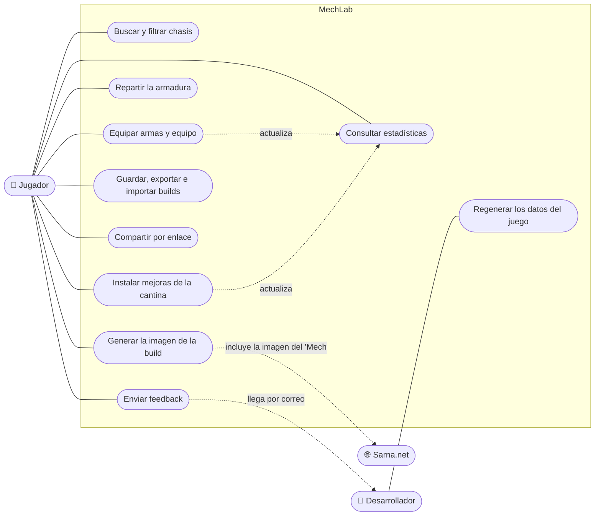
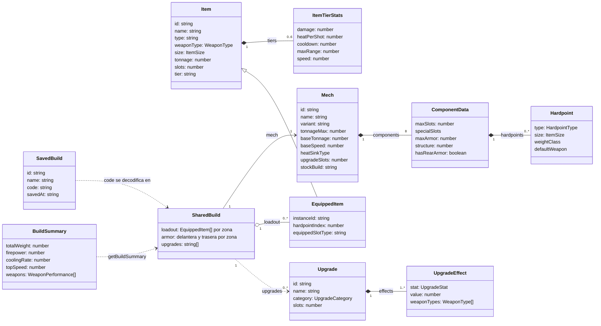
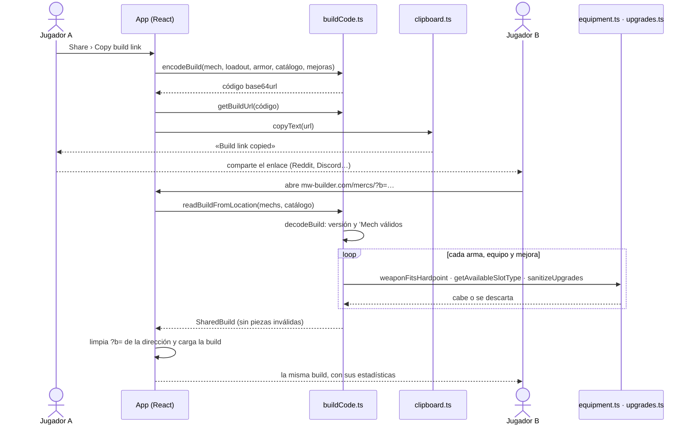
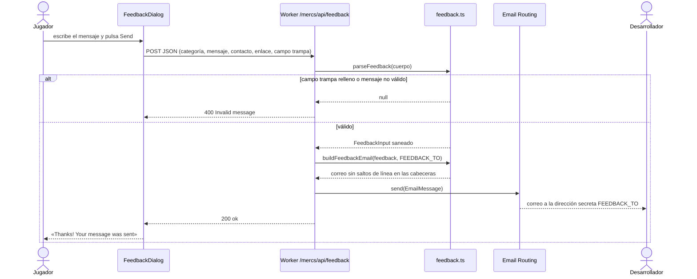

# Diagramas UML

Diagramas en Mermaid (GitHub los dibuja) del uso, el dominio y los dos flujos que salen del navegador. Los nombres de clases y funciones son los del código.

## Casos de uso

Mermaid no tiene diagrama de casos de uso; este usa su notación habitual: actores a los lados y casos de uso en óvalos dentro del límite del sistema.

- El **jugador** no necesita cuenta: todos sus casos de uso funcionan sin registro.
- El **desarrollador** regenera los datos con cada parche del juego y recibe el feedback.
- **Sarna.net** es un actor externo: aporta la imagen de cada ’Mech.

## Clases del dominio

Los tipos de `src/types/` y los que producen las funciones de `src/utils/`.

- Un **’Mech** tiene ocho componentes (cabeza, torso central, torsos, brazos y piernas), y cada uno sus **anclajes** con tipo y tamaño.
- Un **objeto** del catálogo se convierte en **objeto equipado** al montarlo: sabe en qué anclaje o ranura está.
- Una **build** es un ’Mech con su equipo por componente, su armadura y sus mejoras. Se guarda o se comparte como un código (`SavedBuild.code`, el parámetro `?b=` del enlace).
- El **resumen** (`BuildSummary`) no se guarda: se calcula siempre a partir de la build con `getBuildSummary`.

## Secuencia: compartir una build por enlace

Lo que ya no cabe (por ejemplo, tras actualizar los datos del juego) se descarta en lugar de fallar, así que los enlaces antiguos siguen abriéndose.

## Secuencia: enviar feedback

La dirección del desarrollador es un secreto del Worker: no aparece en la web ni en el código. Solo se adjuntan enlaces de la propia web, y ningún campo puede añadir cabeceras al correo.
